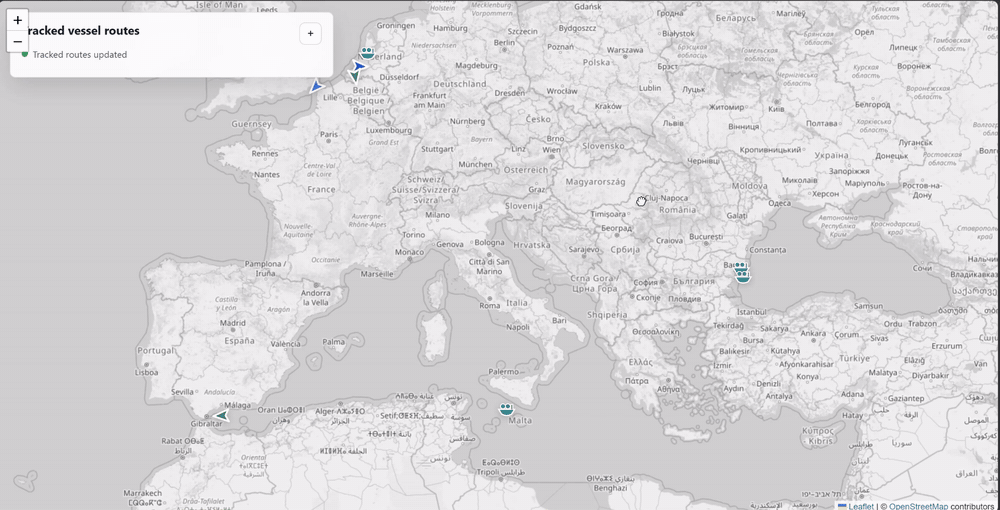
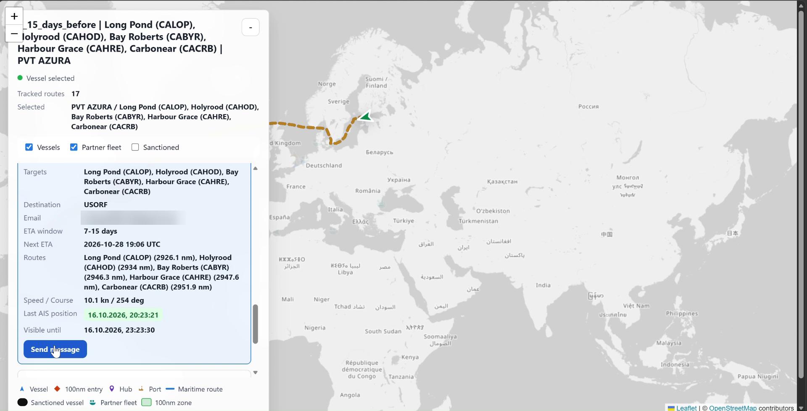
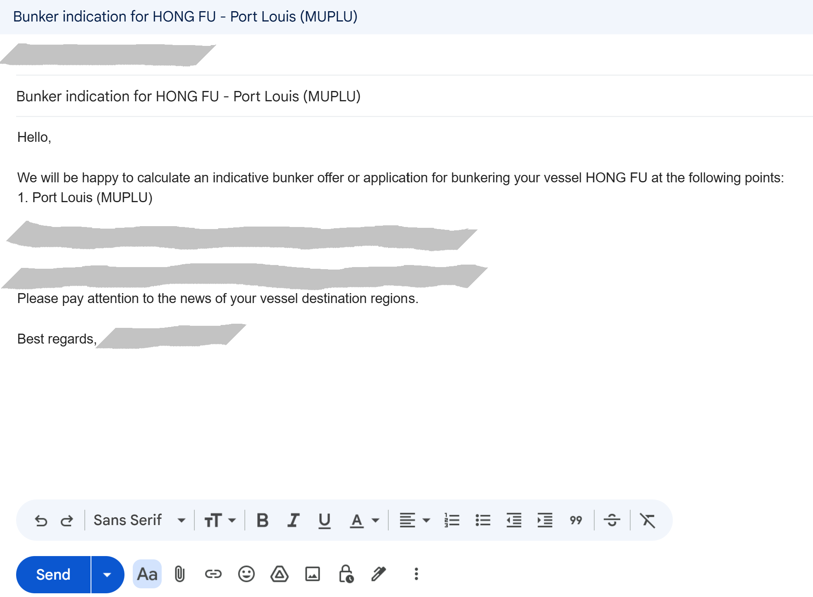
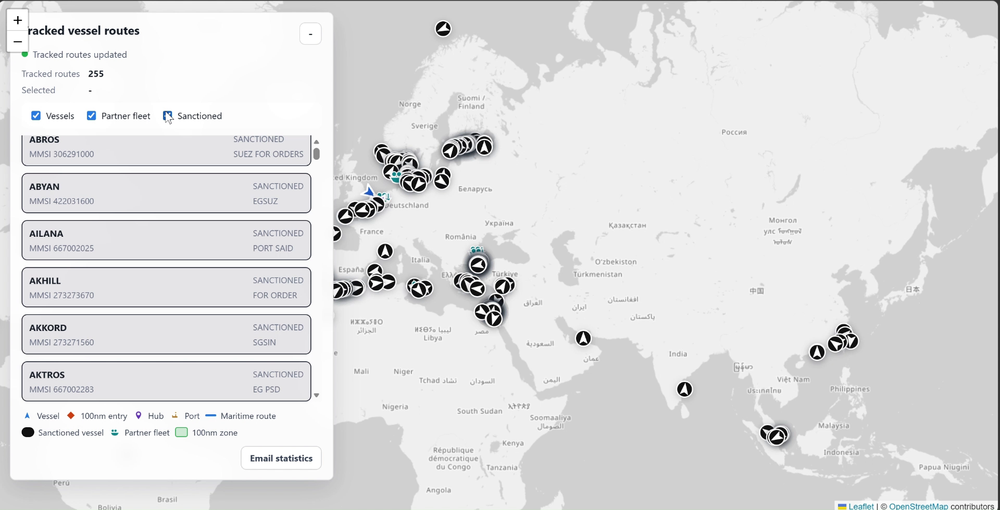
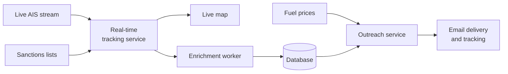

# AIS Vessel Monitoring & Outreach Automation

Real-time maritime intelligence platform for a marine fuel (bunker) supplier. It tracks vessels worldwide from a live AIS feed, predicts which ships will approach the supplier's bunkering hubs, identifies their owners and managers, and sends them personalized fuel offers automatically.

> **Source code and data are private.** This is a commercial project under client confidentiality, so only this overview is public: the code, the database, client details, contacts, and pricing cannot be shown. The screenshots show a limited, non-sensitive part of the system, and personal and commercial data in them is blurred. More detail can be discussed in an interview.

## Highlights

- **Real-time pipeline**: live AIS data stream → async route processing → updates pushed to an interactive map over WebSockets
- **25,700+ vessels**, **4,500+ companies** and **4,500+ validated contacts** collected by an autonomous enrichment worker
- **250+ outreach emails** sent automatically, with delivery tracking and send limits
- **1,900+ sanctioned vessels** from official government sanctions lists, blocked from outreach
- **130+ unit tests**, Docker, deployed to production in the cloud

## Features

### Live vessel map
- Consumes a live AIS data stream and stays resilient to disconnects with automatic reconnects.
- Calculates maritime routes from each vessel's position to its declared destination.
- Identifies vessels approaching the supplier's bunkering hubs using route, timing, and geospatial filters.
- Pushes live updates to an interactive map: vessel routes, hub zones, and vessel cards with speed, course, ETA, and distance to the hubs.

### Autonomous contact resolver worker
A standalone background worker that runs as its own process and, for each vessel, finds the company behind it and that company's contacts, with no manual work.
- **Own job queue** with retries and review states. The main service supervises the worker and restarts it automatically.
- **Vessel → company:** identifies the vessel's owner and manager from public maritime data, using browser automation.
- **Company → contacts:** finds and verifies the company's official web presence and extracts contacts from it.
- **Validation:** every contact gets a confidence score, and only the best contact per company is used. LLM-assisted research fills the gaps.
- **Result:** **4,500+ validated contacts** selected from **6,200+ candidates**, linked to **25,700+ vessels** and **4,500+ companies**.

### Automated outreach
- Ingests up-to-date supplier fuel prices automatically.
- Generates a personalized offer for each vessel based on its route and current prices.
- Sends emails with daily limits, duplicate-send prevention, a suppression list, and bounce tracking.
- Shows delivery statistics right on the map.

### Sanctions compliance
- Maintains a registry of **1,900+ vessels** from official government sanctions lists.
- Matches vessels only by stable identifiers, never by name.
- Shows sanctioned vessels separately on the map and blocks any outreach to them on the backend.

## Architecture (high level)

**Key design decisions:**
- **Real-time tracking is decoupled from heavy processing** with async queues and background workers, so data bursts never slow down the live map.
- **Enrichment runs as an isolated worker process**, so slow automation never affects real-time tracking, and a crash is recovered automatically.
- **Compliance is enforced on the backend**, not only hidden in the UI.
- **Outreach is idempotent**: a restart or redeploy can never send the same message twice.

## Tech stack

**Backend:** Python, AsyncIO, aiohttp, WebSockets, SQLite
**Geospatial:** Leaflet, OpenStreetMap
**Automation & integrations:** Playwright, Gmail API, SMTP, IMAP, LLM-assisted research
**Infrastructure & testing:** Docker, cloud deployment, pytest

---

Built by [Kseniia Kaiuk](https://www.linkedin.com/in/kseniia-kaiuk) · AI / LLM Engineer
